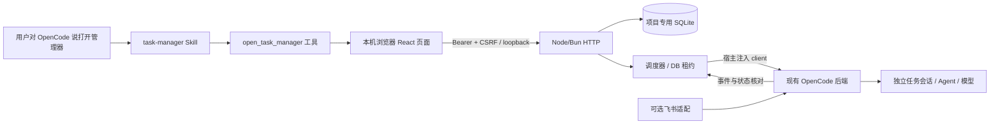

# 架构与行为约定

任务管理器入口 `src/plugin.ts` 由宿主实例化。真实项目路径的 SHA-256 前 24 位作为状态目录键；Windows 常规路径先统一大小写、分隔符和长路径前缀，macOS/Linux 保留原身份。数据不写进项目源码。每个插件实例只管理自身项目，UI 不能选择任意目录或任意已有会话。它不启动第二个 OpenCode，不发现现有后端端口，也不读取模型密钥或飞书配置。

`src/host.ts` 使用注入 client，显式传入项目 directory，保留宿主动态地址和认证。每次运行先读取宿主默认 Agent 的权限，再创建独立会话。默认模型由宿主管理，可选的任务 model 只在创建该会话和提交该次指令时传给宿主。1.19.5 的 v1 SDK 类型遗漏 session create 的 permission 字段，但实际后端支持；真实后端隔离集成脚本验证了它能持久化 ask/deny 规则。

`src/sqlite.ts` 在 Desktop 下解析 node:sqlite，在 Bun CLI 下解析 bun:sqlite；`src/server.ts` 使用 node:http，浏览器启动使用 node:child_process。构建后的 JS 入口避免 Desktop 依赖 Bun 原生模块或 TS 执行器。

`src/store.ts` 使用 SQLite WAL、唯一 `(task_id,slot)`、同步事务与版本检查。定时 slot 为计划触发的 UTC 毫秒；手动 slot 使用 HTTP Idempotency-Key。任务保存具有 revision 乐观锁。运行保留任务名称/版本快照，删除任务后历史仍保留。

数据库租约只允许一个进程拥有调度权，30 秒过期，正常 tick/手动执行/提交前续租。其他进程可以查看与编辑，不能直接执行。无主后最多等待租约超时再接管；接管核对已有会话，不重发。并发上限 2，含等待审批、等待回答及待确认的运行；同任务不重叠。调度繁忙按次记录 skipped。DB 租约不是跨机器集群锁，状态目录不能放网络盘。

`src/engine.ts` 的状态迁移：

- `submitting`：已原子占用 slot，未取得宿主会话。
- `submitted`：已创建会话并提交/等待接受；不是成功。
- `running`：宿主状态为 busy/retry。
- `waiting_approval` / `waiting_input`：只根据对应事件记录，持续占用并发位。
- `succeeded`：宿主 assistant 有完成时间及终态 finish；idle 事件本身不足以成功。
- `failed`：会话错误、assistant 错误或创建会话失败。
- `uncertain`：提交确认丢失、恢复后缺终态证据。不会重发，人工核查/中止。
- `interrupted`：未提交便停止或用户中止并获宿主确认。中止不等于撤销副作用。
- `skipped`：补跑策略、过期或并发限制跳过。

运行版本号避免慢速状态查询把新到的审批事件覆盖掉。事件与轮询共同恢复状态。当前没有跨远端副作用的 exactly-once 保证：HTTP 接受与本地 SQLite 不存在分布式事务，故采用「不明结果不自动重试」以避免重复外部操作。

插件 `dispose` 与实例销毁事件停止 HTTP、timer，释放租约；OS 退出结束进程。没有 launchd、cron 或其他常驻安装。已有会话交给宿主后独立存在；停止管理器不自动中止所有宿主会话。关闭项目或卸载前需自行中止不想继续的运行。

时间规则、夏令时与补跑边界见 README；当前提供每天/每周、固定间隔、单次，不支持任意 cron 表达式、节假日历或唤醒设备。
